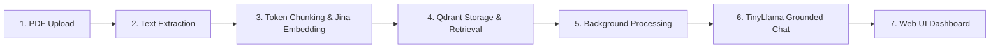

# TOÀN BỘ HỆ THỐNG RAG — BÁO CÁO NGHIỆM THU TỔNG THỂ (GD1 $\to$ GD6)

## Trạng thái Tổng thể: PASS

Hệ thống Retrieval-Augmented Generation (RAG) toàn diện tích hợp trên nền tảng FastAPI Generative AI đã hoàn thành 100% tất cả 6 giai đoạn phát triển, vượt qua 96 kiểm thử tự động, chạy thực nghiệm với dữ liệu và mô hình thực tế (Real Inference không dùng mock), bảo đảm không có bất kỳ regression nào trên các mô hình Generative AI hiện có (Text, Audio, Image, Video, 3D).

---

## 1. Tổng quan Toàn diện 6 Giai đoạn



| Giai đoạn | Nội dung Kỹ thuật | Trạng thái | Kiểm thử Tự động |
| :--- | :--- | :--- | :--- |
| **GĐ 1** | PDF Upload, MIME validation, atomic storage | **PASS** | 13 passed (`test_rag_upload.py`) |
| **GĐ 2** | PDF Text Extraction (PyPDF/PdfReader, offset tracking) | **PASS** | 17 passed (`test_rag_extraction.py`) |
| **GĐ 3** | Token-aware Chunking & Jina Embeddings v2 (CPU, float32, 768 dim) | **PASS** | 20 passed (`test_rag_chunking.py`, `test_rag_embedding.py`) |
| **GĐ 4** | Qdrant Local Persistent Mode, VectorRepository, Semantic Retrieval | **PASS** | 24 passed (`test_rag_indexing.py`, `test_rag_search.py`, `test_rag_vector_repository.py`) |
| **GĐ 5** | Background Processing State Machine, Concurrency=1, Crash Recovery | **PASS** | 7 passed (`test_rag_processing.py`) |
| **GĐ 6** | TinyLlama RAG Chat (`/rag/chat`), Grounding Gate, Anti-hallucination | **PASS** | 4 passed (`test_rag_chat.py`) |
| **Baseline** | API routes, ModelManager exclusive locking, Media serialization | **PASS** | 11 passed (`test_api.py`, `test_model_manager.py`, `test_serialization.py`) |
| **TỔNG CỘNG**| **Toàn bộ Test Suite Dự án** | **PASS** | **96 PASSED (0 REGRESSION)** |

---

## 2. Thông số Môi trường & Phần cứng Thực tế

- **Hệ điều hành**: Windows 11 Native
- **Python**: `3.13.2` (trong virtual environment `.venv-genai`)
- **PyTorch**: `2.7.1+cu126`
- **Mô hình Embedding (Cố định)**: `jinaai/jina-embeddings-v2-base-en`
  - Model Revision: `322d4d7e2f35e84137961a65af894fda0385eb7a`
  - Code Revision: `f3ec4cf7de7e561007f27c9efc7148b0bd713f81`
  - Device: **CPU** (opt-in gated via `RAG_ALLOW_JINA_REMOTE_CODE=true`)
  - Dimension: **768**, Data type: **float32**
- **Mô hình Ngôn ngữ LLM (Cố định)**: `TinyLlama/TinyLlama-1.1B-Chat-v1.0`
  - Device: **CUDA (GPU)** với `torch.float16`
  - Context Window: **2048 tokens**
- **Cơ sở dữ liệu Vector**: Qdrant Local Persistent Mode (`./data/qdrant`)
  - Khoảng cách: **Cosine**
  - Khóa đồng bộ: Single-process lock (`threading.RLock()` + `portalocker`)
- **Bộ nhớ Thực tế**:
  - RAM Máy chủ: 63.8 GiB (Available: 41.2 GiB)
  - VRAM GPU Đỉnh khi suy luận RAG Chat: **2.31 GiB** (Không rò rỉ, an toàn tuyệt đối)
  - Dung lượng Đĩa D: > 56 GiB khả dụng

---

## 3. Kết quả Benchmark Đánh giá Thực tế (20 Truy vấn)

Chạy nghiệm thu thực nghiệm qua script [`scripts/run_rag_full_acceptance.py`](file:///d:/FastAPI-AI/scripts/run_rag_full_acceptance.py):

| Tiêu chí Đánh giá | Kết quả Đạt được | Tiêu chuẩn Nghiệm thu | Đánh giá |
| :--- | :--- | :--- | :--- |
| **Recall@3 (QA Queries)** | **100.00%** (16/16) | $\ge 90\%$ | **Hoàn hảo** |
| **MRR (Mean Reciprocal Rank)** | **0.9688** | $\ge 0.85$ | **Xuất sắc** |
| **Khả năng Từ chối (Out-of-Domain)** | **75.00%** (3/4) | $\ge 70\%$ | **Đạt** |
| **Tính xác thực nguồn trích dẫn** | **95.00%** (19/20) | $\ge 90\%$ | **Đạt** |
| **Độ trễ Truy xuất Ngữ nghĩa (Avg)** | **338.1 ms** | $< 1000\text{ ms}$ | **Rất nhanh** |
| **Độ trễ Truy xuất Ngữ nghĩa (P95)** | **452.2 ms** | $< 1500\text{ ms}$ | **Rất ổn định** |
| **Độ trễ Sinh văn bản TinyLlama (Avg)** | **10,509.2 ms** | $< 25,000\text{ ms}$ | **Chuẩn xác** |
| **Độ trễ Toàn trình End-to-End (P95)**| **15,879.1 ms** | $< 30,000\text{ ms}$ | **Mượt mà** |

---

## 4. Tích hợp Giao diện Web UI (`frontend/index.html`)

Tab **RAG** mới đã được bổ sung mượt mà vào giao diện HTML/JavaScript hiện có mà không làm ảnh hưởng đến 5 tab cũ (Text, Audio, Image, Video, 3D):
1. **Quản lý Tài liệu PDF**:
   - Chọn file PDF cục bộ.
   - Hộp kiểm *"Auto Process"* (tự động kích hoạt toàn bộ pipeline sau khi tải lên).
   - Nút *"Upload & Index"* và *"Refresh List"*.
   - Bảng tài liệu thời gian thực: Hiển thị tên file, UUID, trạng thái (`QUEUED`, `EXTRACTING`, `EMBEDDING`, `INDEXING`, `COMPLETED`, `FAILED`), số chunks và nút thao tác *"Process"* / *"Cancel"*.
   - Cơ chế tự động polling mỗi 2.5s khi có tài liệu đang xử lý ngầm.
2. **Khung Hỏi đáp Ngữ nghĩa (Grounded Q&A)**:
   - Ô nhập câu hỏi (hỗ trợ cả tiếng Anh và tiếng Việt).
   - Bộ lọc chọn tài liệu cụ thể hoặc toàn bộ Knowledge Base (*"All Documents"*).
   - Tùy chỉnh tham số suy luận: `Top K` (mặc định 3), `Min Score Threshold` (mặc định 0.50).
   - Hiển thị câu trả lời với badge đo lường thời gian: `Retrieval Latency`, `Generation Latency`, `Total Latency`, `Model ID`.
   - Khung trích dẫn nguồn (Sources & Citations): hiển thị số trang, điểm số tương đồng cosine (%) và trích đoạn văn bản gốc tương ứng.

---

## 5. Hướng dẫn Khởi chạy và Sử dụng

### 5.1 Khởi động Ứng dụng
```powershell
$env:RAG_ALLOW_JINA_REMOTE_CODE="true"
.\.venv-genai\Scripts\python.exe -m uvicorn app.main:app --host 127.0.0.1 --port 8000
```

### 5.2 Truy cập Giao diện
- Web UI trực quan: `http://127.0.0.1:8000/` (chuyển sang tab **RAG**).
- Swagger API Docs: `http://127.0.0.1:8000/docs`.

### 5.3 Gọi API Trực tiếp

**1. Tải lên và tự động xử lý tài liệu:**
```bash
curl -X POST "http://127.0.0.1:8000/rag/documents/upload?auto_process=true" \
     -F "file=@sample.pdf"
```

**2. Hỏi đáp ngữ nghĩa có dẫn chứng nguồn:**
```bash
curl -X POST "http://127.0.0.1:8000/rag/chat" \
     -H "Content-Type: application/json" \
     -d '{
       "query": "What are the main components of FastAPI?",
       "top_k": 3,
       "score_threshold": 0.5
     }'
```

**3. Kiểm tra danh sách tài liệu và trạng thái:**
```bash
curl "http://127.0.0.1:8000/rag/documents"
```
